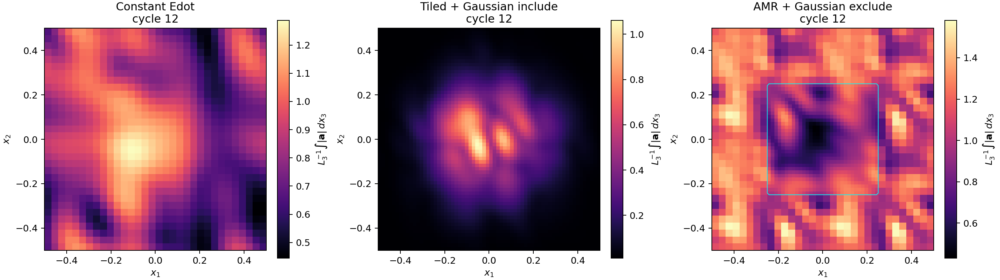

# Example: Localized And AMR Turbulence Driving

These short `turb` problem-generator calculations demonstrate the driver
controls and write the applied acceleration with `variable=turb_force`. They
are validation examples, not statistically converged turbulence experiments.

The default mode is `normalization=accel_rms`, with an explicit `accel_rms`
strength. The power-controlled examples select `normalization=edot`
explicitly. All cases apply one full-timestep kick at the final RK stage.

## Build And Run

From the repository root:

```bash
cmake -S . -B build-turb -DPROBLEM=turb -DCMAKE_BUILD_TYPE=Release
cmake --build build-turb -j

mkdir -p run/turb_edot_fixed run/turb_tiled_include run/turb_amr_exclude
build-turb/src/athena -d run/turb_edot_fixed \
  -i inputs/hydro/turb_driving/constant_edot_fixed_grid.athinput
build-turb/src/athena -d run/turb_tiled_include \
  -i inputs/hydro/turb_driving/tiled_localized_include.athinput
build-turb/src/athena -d run/turb_amr_exclude \
  -i inputs/hydro/turb_driving/amr_localized_exclude.athinput
```

The `-d` option keeps each case's `bin/` and history files in its run
directory.

## Cases

### Constant Energy Injection

`constant_edot_fixed_grid.athinput` uses a $32^3$ periodic uniform grid and

```text
normalization = edot
dedt          = 0.1
```

It supplies the homogeneous baseline for checking requested energy injection.
In this periodic box, with no other energy sources, the total energy should
increase by `dedt * volume * dt` each driven cycle, including cycle zero when
`tdriv_start=0`. The kick itself preserves thermal energy; later fluid
evolution can convert kinetic energy to heat.

### Tiled Included Region

`tiled_localized_include.athinput` uses

```text
normalization = accel_rms
accel_rms     = 0.3
tile_nx       = 2
tile_ny       = 2
localization  = include
sigma_x1      = 0.18
sigma_x2      = 0.18
sigma_x3      = 0.28
```

The same realization repeats over $2\times2\times1$ tiles and is
concentrated near the origin.

### Adaptive Excluded Region

`amr_localized_exclude.athinput` uses location-based adaptive refinement
around the origin, the same $2\times2\times1$ tile pattern, and
`localization=exclude`. Its refined central region is suppressed while
driving remains active outside. It selects `normalization=edot` with `dedt=0.1`.

## Projected Acceleration

The committed figure predates the full-timestep kick update and illustrates
the spatial controls; it is not validation of the current integration. It
was generated from cycle-12 `turb_force` dumps. Each panel
shows $L_3^{-1}\int|\boldsymbol{a}|\,dx_3$; the cyan contour in the AMR
panel marks the level-0/level-1 interface.



Checks to make when rerunning the committed inputs are:

| Case | Check |
| --- | --- |
| Constant energy injection | Per-cycle total-energy increase equals `dedt * volume * dt` within numerical error. |
| Tiled included region | Volume-weighted RMS of `turb_force` equals `accel_rms=0.3`; acceleration is concentrated near the selected region. |
| AMR excluded region | Refinement does not add statistical weight to fine cells; acceleration is suppressed near the selected region. |

These energy and RMS checks concern the applied force. The raw modal OU
coefficients are subsequently localized, mean-subtracted, and normalized.
Exact injected work is separate from the temporal accuracy of the coupled
fluid evolution, which uses first-order splitting.

## Single-Kick Validation

The single-kick double-precision validation passed serial and two-rank MPI
regressions. All three production examples above
also ran successfully: both power-controlled cases matched their per-cycle
energy budgets, and the included-region case retained RMS acceleration 0.3.

A matched comparison of development `b6035d254` and single-kick `a97bc75ad`
used a periodic unit box with $64^3$ cells, eight MPI ranks, RK3/WENO-Z/HLLC,
CFL 0.3, and $\gamma=1.00001$, initially at rest with $\rho=p=1$.
Both used `accel_rms=0.37`, solenoidal parabolic modes 1--3 peaked at mode 2,
directional mode bounds $-3$ to $3$, and seed 2718. They ran for three nominal
turnover times $\tau=(L/2)/(0.5c_{s,0})$, with `tcorr` equal to $\tau$ and
`dt_update` equal to $\tau/100$.

Over the last nominal turnover, the single-kick mean mass-weighted 3D RMS
Mach number differed by $+0.035\%$ and the mean
$\sigma_\rho/\langle\rho\rangle$ by $-0.021\%$ relative to development.
Final total-energy gain differed by $-0.114\%$.
Source instrumentation confirmed that single-kick work matched its
kinetic-energy change to roundoff; the development stage updates did not.
Similar bulk statistics do not imply identical trajectories: the final fields
$\rho/\langle\rho\rangle-1$ and $\boldsymbol{v}-\langle\boldsymbol{v}\rangle$
differed by about 17% and 16% in relative L2 norm, using volume averages and
development norms as denominators. Neither run was an accuracy reference,
and three nominal turnovers from rest do not establish converged turbulence
statistics. Three alternating-order timing repetitions showed substantial
run-to-run variation and do not support a general performance claim.

A separate time-refinement experiment used a periodic one-dimensional unit
box with 128 cells, uniform ideal hydro ($\rho=p=1$, $\gamma=5/3$), RK3/PLM/HLLC,
and one compressive mode (`nlow=nhigh=1`, `spectrum=power_law`,
`min_kx=max_kx=1`, `max_ky=max_kz=0`, `sol_fraction=0`, `rseed=2718`). With
`accel_rms=0.01`, `dt_update=1`, `tcorr=1e6`, and final time 0.2, the modal field
is frozen. Halving CFL through 0.4, 0.2, 0.1, and 0.05 gave density/momentum
self-convergence orders 0.997--1.001 on the same spatial grid; CFL 0.003125
provided an additional reference. The applied acceleration varied by less
than $6\times10^{-12}$. This confirms the expected first-order deterministic
coupling for this smooth fixed-RMS problem.
It does not establish stochastic convergence or GPU performance.

Strongly compressible validation remains incomplete. Exploratory $64^3$
hydro and MHD runs with $\gamma=1.00001$, RK3/WENO-Z, fixed-RMS driving
targeting Mach 5, and CFL 0.3 encountered floor activations and terminated
before three nominal turnover times. These runs did not isolate the cause
of failure. Exact work in an individual kick does not guarantee positivity
or stability of the complete fluid calculation.

## Earlier Modal-State Benchmark

Three Release runs of each input were compared against the initial feature
prototype at commit `a84c7ffd`; the table reports median executable CPU time.
These measurements predate the full-timestep kick update and have not been
repeated for the current integration.
These short total-runtime measurements include integration and output work,
not only driver kernels.

| Case | Prototype CPU time (s) | Modal-state CPU time (s) | Ratio |
| --- | ---: | ---: | ---: |
| Constant energy injection | `0.12035` | `0.11882` | `0.987` |
| Tiled included region | `0.22149` | `0.24983` | `1.128` |
| AMR excluded region | `0.27642` | `0.28859` | `1.044` |

The correctness change removes the prototype's two cell-sized OU scratch
arrays (`force_tmp1` and `force_tmp2`) and replaces them with two modal
innovation arrays. For these inputs, at double precision, the removed cell
storage is `2.93 MiB`, `5.86 MiB`, and `40.50 MiB`, respectively; the new
modal innovations use `1.31 KiB` in all three cases. The measured tiled-case
overhead is retained as evidence for any future kernel-level optimization
rather than hiding it behind unprofiled changes.

Regenerate the figure after running the examples:

```bash
python vis/python/plot_turbulence_driving_projection.py \
  --panel "Constant Edot=run/turb_edot_fixed/bin/turb_edot_fixed.force.00004.bin" \
  --panel "Tiled + Gaussian include=run/turb_tiled_include/bin/turb_tiled_include.force.00004.bin" \
  --panel "AMR + Gaussian exclude=run/turb_amr_exclude/bin/turb_amr_exclude.force.00004.bin" \
  --output docs/source/_static/turbulence_driving_projections.png
```

## Regression Coverage

The regression fixture is distinct from the `turb` examples. From the
repository root, build it and run the CPU tests from the binary directory:

```bash
cmake -S . -B build-turb-tests -DPROBLEM=tests/turb_forcing -DCMAKE_BUILD_TYPE=Release
cmake --build build-turb-tests -j
cd build-turb-tests/src
python3 -m pytest ../../tst/test_suite/turb/test_turb_driving_cpu.py
```

The standard `tst/run_test_suite.py` CPU and MPI runs also build this fixture
when needed, without replacing the executable used by the other tests.

The turbulence regression tests exercise:

- conserved-state kick work and thermal-energy preservation with stale primitives;
- per-cycle fixed-power injection for RK1--RK4, including the first cycle;
- combined two-fluid work and momentum for ImEx2, ImEx2+, and ImEx3;
- default RMS acceleration and zero-target forcing;
- cycle-start activation and deactivation of finite driving windows;
- zero power with opposing flow and cancellation-resistant power normalization;
- rejection of non-finite density and work integrals before force normalization;
- fixed-RMS normalization with tiling and inclusion localization;
- AMR execution with exclusion localization;
- exact rendered-force and final-history continuation across fixed-grid and AMR restarts;
- MPI execution of the AMR/localized case and periodic MHD energy budget;
- rejection of removed parameter names and singular parabolic spectra.

The driver uses precision-correct MPI reductions. In the tested development
checkout, a complete single-precision executable did not build with AppleClang:
unchanged coordinate and tabulated-EOS translation units contained
single-precision type/narrowing errors. Those blockers were outside this feature.

The equations, restart contract, and full canonical parameter reference are
in {doc}`../modules/turbulence_driving`.
